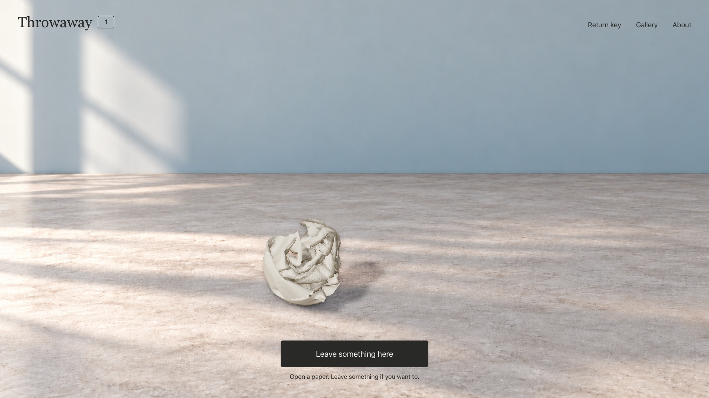
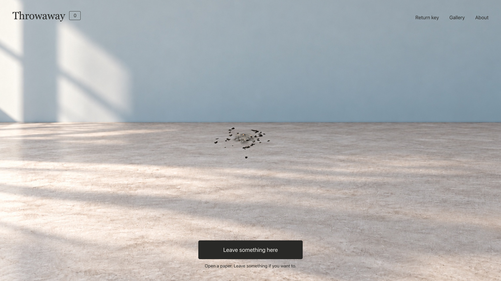
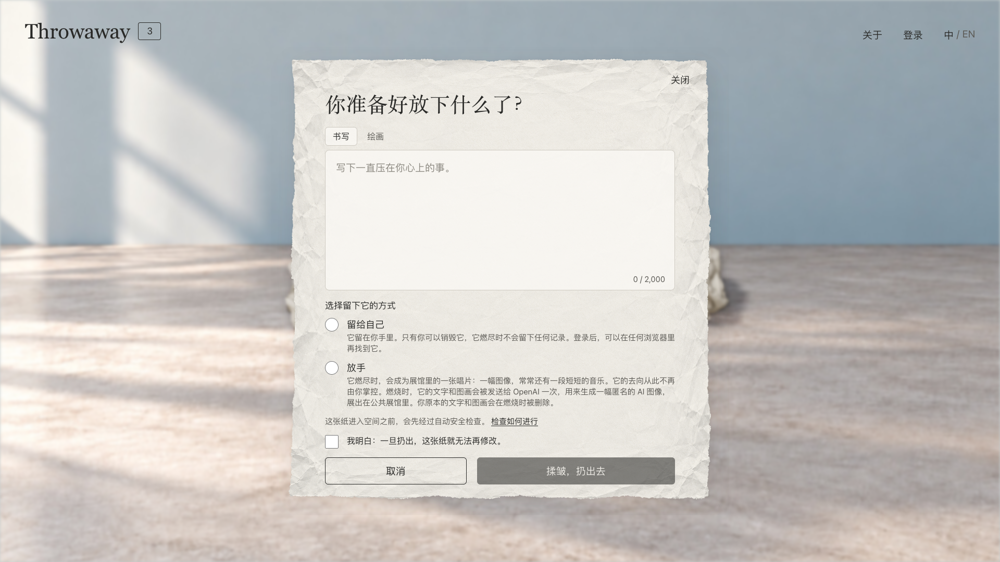
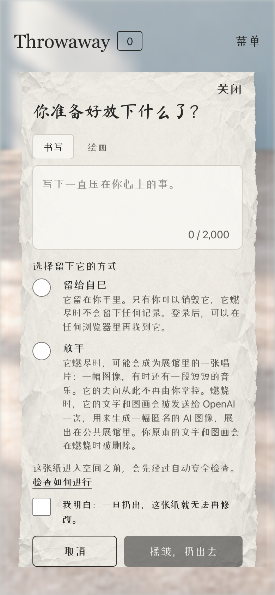

# Process overview

## Choosing the project and its rules

I used Codex to compare ideas and asked it to question my choices one at a time. I chose Throwaway because I wanted a place to put down a thought and a chance to recognise something of myself in a stranger's paper. Robin Sloan's [account of making an app for his family](https://www.robinsloan.com/notes/home-cooked-app/) gives me a way to explain the scale I wanted. Even in a room open to strangers, one paper can be enough for a visit. I left out comments and gave readers “I saw it” so they could acknowledge a paper and leave. I wrote the first README and used Build Web Apps to turn it into a Week 9 plan with visual references. The agent got rules in `CLAUDE.md` and checks for persistence and safe retries in `spec/` ([`7d955b3`](https://github.com/comp4020-agentic-coding-studio/comp4020-final-aurorasundev/commit/7d955b3), [`e1f8d44`](https://github.com/comp4020-agentic-coding-studio/comp4020-final-aurorasundev/commit/e1f8d44), [`90fa5fb`](https://github.com/comp4020-agentic-coding-studio/comp4020-final-aurorasundev/commit/90fa5fb), [`df3bd71`](https://github.com/comp4020-agentic-coding-studio/comp4020-final-aurorasundev/commit/df3bd71)).

## Stack and early decisions

React and Vite handle the writing and reading screens. Three.js runs the physical paper outside React's render loop, using the MIT-licensed [Paper Crumple demo](https://github.com/item-develop/paper-crumple-demo). I kept the words in HTML so a closed 3D paper reveals nothing. Express and SQLite keep the API and durable state on one Fly.io machine. That made it easier to follow an action from one visitor to another. Scaling to several machines would need another storage plan ([`83c6fdc`](https://github.com/comp4020-agentic-coding-studio/comp4020-final-aurorasundev/commit/83c6fdc), [ADR 001](docs/adr/001-sse-snapshots.md)).

I chose HTTP plus server-sent events in Week 10 because saving, witnessing and burning produce occasional shared changes. The server can push those changes in one direction while dragging and camera motion stay local. A reconnect reads the current snapshot, so someone who was offline will miss the old burn animation. The furnace gave that split a visible consequence. Placing a paper inside confirms destruction on the server before any fire starts. Claude built the foundation, then I brought in Codex to improve the iron, camera and ash against my references. I later asked for a regression check for the order of confirmation and fire ([`2a9f943`](https://github.com/comp4020-agentic-coding-studio/comp4020-final-aurorasundev/commit/2a9f943), [`75e3256`](https://github.com/comp4020-agentic-coding-studio/comp4020-final-aurorasundev/commit/75e3256), [`5cd0470`](https://github.com/comp4020-agentic-coding-studio/comp4020-final-aurorasundev/commit/5cd0470)).

I checked this across two visitors, not one: two independent browser sessions, A and B, open on the same room. A throws a Release paper; it lands in B's room with no reload. B burns it; it turns to ash on A's screen with nothing pressed there. To see whether it held up under use I hadn't designed for, I also did a stress test ([ADR 010](docs/adr/010-persistence-and-migration-backups.md)).

For moderation, I wanted an unavailable check to leave the draft with its writer, and conflicting reports to go to an operator. Small real-provider checks verified the connection. Fixtures covered recovery and concurrency. These gave me two different kinds of evidence for the same decision ([ADR 004](docs/adr/004-configured-safety-review.md), [`351439c`](https://github.com/comp4020-agentic-coding-studio/comp4020-final-aurorasundev/commit/351439c)).

## What changed when I used the Gallery

Claude's first Gallery could browse, open and report works, but its grid and dialog felt static. I found the Goodgrowth case study and used desktop and phone references to specify paper sleeves, vinyl and an orbit. For opening a record, I could finally say what “smooth” meant to me: the disc turns behind the sleeve, clears its edge, and only then moves in front. The grid remains available for reduced motion and browsers without WebGL ([`56c226a`](https://github.com/comp4020-agentic-coding-studio/comp4020-final-aurorasundev/commit/56c226a), [`2d6b286`](https://github.com/comp4020-agentic-coding-studio/comp4020-final-aurorasundev/commit/2d6b286), [`243bca8`](https://github.com/comp4020-agentic-coding-studio/comp4020-final-aurorasundev/commit/243bca8), [`08d1c23`](https://github.com/comp4020-agentic-coding-studio/comp4020-final-aurorasundev/commit/08d1c23)).

I also learned to check what a visitor could actually do. A test kept the visible collection under 48, but later works could never be reached. In the phone viewport, transparent padding blocked a visible Back button. Those defects gave me clearer things to check. Could I get to the last work? Could I press Back? Did the change from WebGL to HTML flash? For Crit 10 we also added readable log aliases, so I could tell who acted and whose attempt was refused without putting paper text or credentials in the logs ([`e7b4fcd`](https://github.com/comp4020-agentic-coding-studio/comp4020-final-aurorasundev/commit/e7b4fcd), [`51cc127`](https://github.com/comp4020-agentic-coding-studio/comp4020-final-aurorasundev/commit/51cc127), [`6c26f06`](https://github.com/comp4020-agentic-coding-studio/comp4020-final-aurorasundev/commit/6c26f06)).

I wanted burning to end the paper's life. We moved extraction of the creative brief to ignition. The server clears the original as part of the burn. If extraction fails, the paper leaves no record. The brief gives the Gallery an image and, when available, a score that Web Audio plays in the browser. After music went live, I listened and found the pieces too similar. I wanted to hear what a feeling could turn into after the burn. I chose to have sadness turn towards brightness and anger towards calm, and asked Claude to expand the colours, timbres and tempo to make that range possible. The new direction is now deployed ([`05f31e7`](https://github.com/comp4020-agentic-coding-studio/comp4020-final-aurorasundev/commit/05f31e7), [`fdd30bd`](https://github.com/comp4020-agentic-coding-studio/comp4020-final-aurorasundev/commit/fdd30bd), [`74c1291`](https://github.com/comp4020-agentic-coding-studio/comp4020-final-aurorasundev/commit/74c1291), [ADR 008](docs/adr/008-rebirth-reversal.md)).

I checked publication and listening separately. In an isolated database, two of three synthetic samples passed inspection and were published there. The third was blocked and its image was deleted. That showed the real service and inspection path working ([preflight](docs/evidence/gallery-generation-preflight-2026-10-20.md)). To judge the contrast, I asked someone outside the project to compare two tracks. They heard a clear difference and liked the music, though the moods they heard only partly matched what I intended ([listening notes](docs/adr/008-rebirth-reversal.md#listening-check)).

## Giving people a reason to come back

My tutor asked why someone would return, and two friends asked how they could see their own papers again. I had avoided accounts because I wanted the room to feel anonymous. But a return key only restored my right to burn a Keep. I could still spend a visit looking for it. I also wanted to hear the record my own paper had become. I chose an optional account with a private panel and kept the room and Gallery anonymous to others. I chose to collect no email address, which means a forgotten password cannot be recovered. In the panel I separated the papers I can still let go from the ones I have handed over to readers, and put their resulting records below ([`0642dae`](https://github.com/comp4020-agentic-coding-studio/comp4020-final-aurorasundev/commit/0642dae), [`2a507e1`](https://github.com/comp4020-agentic-coding-studio/comp4020-final-aurorasundev/commit/2a507e1), [ADR 009](docs/adr/009-optional-accounts.md)).

We checked the account migration and permissions, tested the panel in local Chromium at the course's desktop and phone sizes, and backed up the live database before deployment. I tried the account flow myself on the live site and it worked. That was the final check I wanted for the change in how someone comes back to Throwaway ([browser evidence](docs/evidence/accounts-2026-11/README.md), [release run 41795798041](https://github.com/comp4020-agentic-coding-studio/comp4020-final-aurorasundev/actions/runs/41795798041)).

## Making the choices readable

I added English and Simplified Chinese because I wanted visitors to understand what they were agreeing to when they left a paper. Keep and Release change who can burn it, so that choice needs to be clear in either language. Using the browser language would save some visitors a click. I used a switch so visitors can choose a language for this room, and the browser remembers their choice. Translating the papers would help more people read them, but it could change the tone of what someone left, and a drawing has no text to translate anyway; typed words are a cost I haven't taken on. I kept each paper in the words its writer chose. The tests check that the writing sheet switches to Chinese, that the choice survives a reload, and that an opened paper still shows the original words ([`d3b2e88`](https://github.com/comp4020-agentic-coding-studio/comp4020-final-aurorasundev/commit/d3b2e88), [`4c892dc`](https://github.com/comp4020-agentic-coding-studio/comp4020-final-aurorasundev/commit/4c892dc)).

