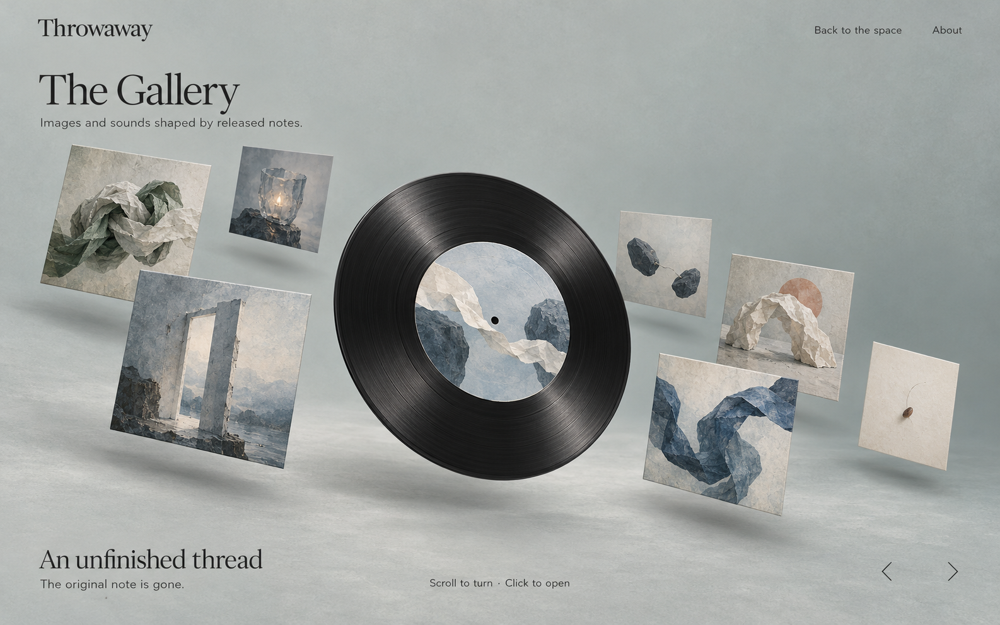
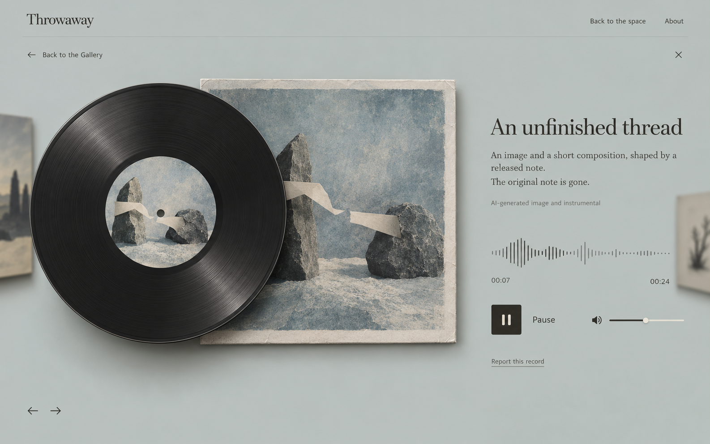
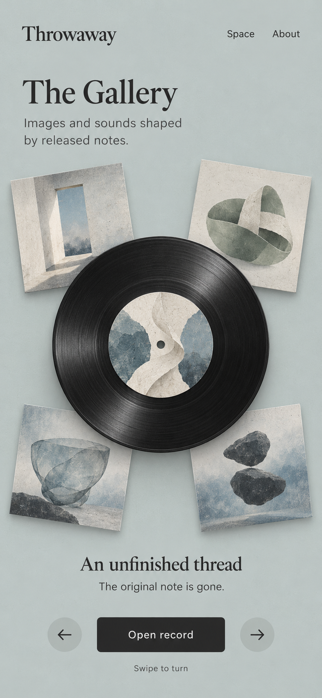

# Throwaway — a record exhibition of things let go

Date: 2026-10-18. Status: **Direction A selected by the owner; application implementation has not started in this design pass**.

The owner selected **A — the mineral-grey record exhibition** on 2026-10-18. G01, G02 and G03 are the only active visual references. Keep the existing `plans-gallery-ai.md` and completed implementation intact; this selection records the visual direction and does not by itself approve all proposed timing/music details or start product implementation.

## 1. What this Gallery means

A note is something a person wants to put down. Its disappearance does not mean the experience had no value. The Gallery gives that experience another, anonymous form: **an image, and optionally a short instrumental, shaped by the content of that particular burned note**.

This is an exhibition to encounter, not an archive of people's stories. There are no original notes, authors, dates, popularity metrics, comments, profiles or links back to papers. Do not turn it into a music-streaming product. A visitor can rotate the collection, open one record, and choose to listen.

The owner's latest requirements take precedence over the earlier plan:

- Existing **Release** remains the only author choice. No additional Write checkbox or Gallery opt-in.
- Only successfully burned Release papers qualify. A Keep author burning their own paper does not create a record.
- Each image must derive from its own note's text/drawing. A common art direction does not mean a generic image shared by every note.
- Extract the creative meaning **when the paper is ignited**, alongside the existing burn; do not add a new pre-ignition waiting screen or make writing wait for this step.
- Prefer small changes to the completed app. Keep the furnace, source-deletion transaction, permissions, witnessing, existing burn request/receipt and paper real-time behavior.
- A short instrumental is a proposed extension, not an already configured or verified service.

## 2. Reference study and what to borrow

I inspected [GoodGrowth](https://goodgrowth.com/) in a browser and read the [author's Codrops case study](https://tympanus.net/codrops/2026/08/27/goodgrowth-boot-sequences-spinning-discs-and-the-art-of-the-portfolio/). The case uses Three.js, GSAP and Web Audio, with an orbiting project band and a central disc. Its orthographic composition, scroll detents and separation of audio scheduling from rendering are useful references.

Borrow the interaction grammar: a diagonal orbital collection, tactile central disc, wheel/drag rotation, deliberate stopping positions, and a focused transition into one item. Build our own scene, code, sounds and artwork. The case-study page does not itself establish that the site's complete source and assets are licensed for reuse; no direct project-source repository was verified. This proposal does not depend on obtaining its private code.

Selected direction and accessible fallback:

| Direction | Benefit | Cost | Recommendation |
| --- | --- | --- | --- |
| Keep the current square grid | Smallest UI change and simple fallback | Does not deliver the user's desired record encounter | Retain only as an accessible/low-motion fallback |
| Translate the orbit into Throwaway's material world | Preserves the compelling interaction and gives the whole site a coherent identity | Needs careful material, spacing and transition work | **Selected direction A, G01–G03** |

Visual unity does not require every page to be identical. The room is where a paper is let go; the Gallery is a second room where an image and sound can be encountered. They share typography, mineral tones and tactile surfaces. The Gallery adds records and more deliberate depth.

## 3. Visual references and their authority

All images below were generated with the built-in Image Gen tool. They are concept art with invented example content, not screenshots of a running app and not images generated from real visitors' notes. Final prompts are in [image-prompts.md](image-prompts.md).

| Image | Purpose | Use |
| --- | --- | --- |
| [G01 — mineral desktop orbit](reference-images/G01-orbit-desktop-mineral.png) | Selected browsing composition, 1586×992 | Overall hierarchy, diagonal collection, paper sleeves, charcoal record, light/colour |
| [G02 — focused record and listening](reference-images/G02-record-listening-desktop.png) | Desktop detail/playback state, 1586×992 | Full artwork beside the disc, title, real player controls, report action |
| [G03 — mineral phone orbit](reference-images/G03-orbit-mobile-mineral.png) | Mobile browsing composition, 853×1844 | Compact orbit, readable title, explicit Open record and touch controls |

All references use relative paths. Moving the complete project preserves both the reference-image links and the material links into public/. If copying this design folder separately, retain the same relative public/ directory for the fixed material links. The current phone image is a full browsing state; the phone listening state should stack the full square artwork above its caption/player, not shrink the desktop two-column view.

### Selected visual contract

- **G01:** desktop orbit composition and material balance.
- **G02:** focused full-artwork/record composition and playback controls.
- **G03:** phone composition, readable caption and touch controls.
- Keep the current room/Write/Read identity: mineral grey, warm paper, charcoal and the existing serif/sans family roles.
- Covers vary according to their own burned notes; layout, art direction and material treatment stay consistent.
- Playback remains an explicit action. Selecting A is not a claim that music generation is configured or tested.

## 4. Main experience: rotate, encounter, listen

### Browsing

Use one central charcoal vinyl disc, as selected in A. Surround it with square sleeves containing generated artworks. Sleeves preserve complete image composition; the disc's round label is an additional cropped preview of the selected artwork. Opening an item always reveals the complete original square image. Do not discard image content merely to make it fit a record label.

Desktop shows roughly seven nearby sleeves; phone shows four nearby sleeves plus the central record. These are representations of real distinct objects, never duplicate/filler records invented to fill a ring. For fewer records, use one disc or a sparse arrangement. With zero, show an honest empty exhibition rather than sample art.

Wheel movement turns the whole collection. Horizontal pointer dragging works too. On release, the collection gently settles with one item in focus. The central label and HTML caption follow the focused item's ID. Keep orbit motion very restrained at rest; do not constantly sweep the artwork away from someone trying to inspect it.

Use previous/next buttons and Left/Right keys as equivalent controls. Bind wheel/touch interaction to the exhibition stage, not the entire document. Detail/report forms must scroll normally. Keyboard focus, browser navigation and pinch zoom continue to work.

### Opening a record

A click opens the selected object. Over about 650–800 ms the orbit loses depth and moves toward the margins while that record comes forward. The square sleeve becomes the complete image shown in G02. The title, explanation and player remain HTML, not text rendered onto a WebGL texture.

The view states “The original note is gone.” It must not provide an AI-written retelling of the note, a source preview or a quotation. Titles can come from generic, controlled metaphor names such as “An unfinished thread”; they are not the note's first sentence.

### Listening

Sound starts only from a direct Listen/Play action. Turning the ring, hovering, focusing or opening a record does not start music. Only one record plays at a time. Switching, closing, hiding, leaving the page or losing the active view stops it with a short fade. The disc spins slowly while playback is active, decelerates on pause and stays still under reduced motion.

G02's waveform/time represent a proposed **real playing** state. Runtime time comes from audio metadata/currentTime; waveform comes from the actual audio. Do not animate fake audio activity when a track is pending, failed, disabled or absent. Image-only records remain fully viewable.

### Returning and live changes

Closing restores the same focused ID, ring phase and browsing window. A newly published record must not change the current selection or reorder the ring under someone's pointer. Insert into the next idle window. A hidden record disappears immediately, and any playing sound stops; replacement focus chooses the nearest remaining item.

Retain the existing no-replay reconnect behavior and Gallery revision/version guards. Live arrival is a new object, not a reason for every visitor to hear it.

## 5. Art direction: content changes, visual language stays coherent

A: mineral/sage grey `#c6cdcc`, ivory paper `#f3f0e8`, charcoal `#292927`, muted slate blue, soft sage, and occasional restrained colour in the artwork. Use tactile paper fibres, restrained halftone and abstract material collage. Keep faces, legible text, distinctive places and copied note drawings out of output. An abstract doorway or a stone form is a metaphor, not a depiction of someone's actual address or photograph.

The creative brief must choose **what** an image expresses. A style preset chooses **how** it is rendered. Include both in every image prompt. Changing only a random seed or a paper ID does not satisfy content-based generation.

Invented examples, for testing only:

| Example note meaning | Visual metaphor | Related instrumental direction |
| --- | --- | --- |
| A conversation left unfinished | Two forms and an interrupted connecting thread, space between them | Sparse felt-piano phrases with intentional rests; quiet unresolved ending |
| Pressure to satisfy other people's expectations | A folded vessel opening under a slackening band | Restrained low pulses slowly yielding to more spacious tones |
| Leaving a place that mattered | A threshold and a path dissolving into paper grain | Airy sustained tones, a small recurring motif receding into silence |

These are illustrative mappings, not hardcoded per-note templates. Do not infer a diagnosis, reproduce private details or force every sad note into a cheerful ending. Different notes can share a broad metaphor; variation should reflect validated content parameters, not unrelated filler.

## 6. Revised timing: extraction at ignition

Recommended minimal-change choreography:

1. The existing drop/Place action confirms destruction with its existing operation key.
2. In the same synchronous handler, capture a private, bounded in-memory snapshot of that ACTIVE Release paper. Execute the existing authorized conditional burn transaction, which clears content/drawing and records the final receipt. Discard the snapshot unless the result is a **fresh successful Release destruction**.
3. After commit, deliver the existing burn response and paper SSE immediately. Start one bounded creative-brief request from the volatile snapshot while clients play the existing fire. Do not await the model in the burn response or hold a database transaction open around it.
4. When the brief is valid, discard all application references to the source snapshot and persist only the constrained derivative. Image and optional instrumental jobs use this same derivative.
5. Publish inspected image output independently. Attach an inspected/reviewed track later. Their completion is not required to end the fire or return to the space.

**Privacy change to make explicit:** database deletion still happens at confirmed ignition, but the source temporarily exists in the one in-flight AI request/application memory. No raw source is saved in an artifact job, file, log or retry queue. This replaces the older plan's stronger requirement that no post-burn request uses a source snapshot. It does not promise instant physical memory erasure or deletion from a provider's systems. The Write/About disclosure must explain processing accurately.

**Timing recommendation, still for design approval:** preserve the existing `BURN_DURATION_MS = 4800`. Start extraction and fire together. If extraction finishes early, hold image publication until at least that visual ending time. If it finishes late, the ash/ending completes normally while derivative processing continues. Aim to finish extraction within the burn, but do not promise that a network call always takes exactly 4.8 seconds. A bounded request deadline around 8 seconds is a starting point to measure, not a demonstrated latency.

Strict equality would need variable burn timing and a completion signal to the initiator/spectators, adding changes to the working ritual. Holding flames indefinitely, animating fake completion or keeping a raw durable source copy would be poor ways to achieve equality. The recommended version meets the owner's “start together, change little” intent, but the equality requirement is not silently treated as implemented or already approved.

On extraction failure, burn still succeeds. The job records a safe `brief_unavailable`/`source_unavailable` outcome and no unrelated keepsake is manufactured. A process restart can lose this volatile source; that job cannot recover by rereading a deleted original. This is the explicit durability cost of extracting at ignition with immediate deletion and no raw archive.

## 7. Image and sound use one content-derived brief

Replace the old four-value recipe with a versioned constrained `CreativeBriefV2` detailed in [technical-notes.md](technical-notes.md). It should describe metaphor, relation, movement, space, material/colour and a small musical vocabulary. No raw quote, name, actual place, free-form source summary or complete drawing is persisted. The provider must treat the source as data, not instructions.

A new brief is valid only after the model has actually processed this note's source snapshot. Bind the pending result to its private job ID/lease. Merely choosing allowed enum values from a random public ID is not a content-derived result.

Current local source at `7204e31` has `neutralRecipe(publicId)` in `server/artifacts/store.ts`, and `queueDestroyedRelease` uses it if preparation is not ready. This was an intentional fallback in the old plan, but conflicts with the owner's clarified requirement. **Remove that fallback from the new generation path.** Current `server/artifacts/provider.ts` also requests only four enums and a quiet still-life style; it needs the richer brief and the selected new art direction.

Already ended papers cannot be reconstructed. Existing legitimate content-prepared images may remain viewable; content-independent legacy outputs must not be represented as content-derived. Identify them by stored provenance and decide their visibility deliberately, without silently deleting unrelated records or charging for regeneration.

## 8. Technology choices

| Area | Proposed technology | Reason |
| --- | --- | --- |
| App and public state | Existing React/Vite/TypeScript, useGallery and HTTP/SSE | Preserve completed backend, reports and reconnect behavior |
| Orbital exhibition | Existing Three.js 0.160.1, new isolated scene module | Real depth, disc materials and image planes without replacing the room |
| Interaction and transition | GSAP core + Observer | One phase controller for wheel/drag, snapping and focused transitions |
| Smooth scrolling | No Lenis for this stage initially | A full-screen orbital input controller already owns its gestures; avoid two competing smoothing layers |
| Text, focus and controls | HTML/CSS/native dialog | Legibility, keyboard access, responsive layout and existing report behavior |
| Content extraction | Existing server OpenAI Responses adapter with a strict versioned schema | A bounded shared creative brief, not copied note text |
| Cover generation | Existing server image adapter/model, updated prompt | Actual individual images from the shared brief and common style preset |
| Short instrumental | Proposed ElevenLabs Music adapter | Actual model-generated music, separate service/key; not TTS or a stock loop |
| Playback and spectrum | One HTMLAudioElement + optional Web Audio graph | Playback is independent from Three.js; pause/fade/analyser are local effects, not AI generation |
| Persistence | Existing SQLite jobs and private volume; a small audio-job extension | Preserve safe IDs, operator hiding, limits and restart rules |

The GSAP [Observer documentation](https://gsap.com/docs/v3/Plugins/Observer/) supports wheel/touch/pointer input. Three's [orthographic camera](https://threejs.org/docs/pages/OrthographicCamera.html) is suitable for stable editorial composition. The precise controller/math and component boundary are in the technical notes; latest documentation must be checked against the pinned Three version before adding properties.

## 9. Music: an extension with a clear boundary

Recommend a roughly **24-second instrumental**, individually generated from the same brief as its cover. It should be a small composition with a beginning and an ending, without lyrics, a quoted note or imitation of a named performer. It is not a voice reading and should not become a mandatory emotional soundtrack for the entire room.

[ElevenLabs' compose endpoint](https://elevenlabs.io/docs/api-reference/music/compose) accepts a prompt, explicit duration and an instrumental setting. A candidate is `music_v2`, 24,000 ms, MP3 output, `force_instrumental:true`; actual account access, cost and aesthetic quality are unverified. Existing OpenAI credentials do not configure this separate service. No music API was called for this design.

There are three implementation levels:

| Level | What it actually is | Trade-off |
| --- | --- | --- |
| Reused ambient loop | Existing licensed audio with a visual disc | Fast, but not individually generated; does not meet the proposed final experience |
| AI-selected score + browser synthesis | Model chooses notes/tempo; Web Audio performs them | Lower external cost, predictable instrumental output; more synthetic sound |
| **Model-generated instrumental audio** | Music API returns a separate piece for this note | Best fit for the desired exhibition; adds latency, cost, output checks and storage |

Treat the third as the proposed target; do not label either earlier level as an already working music-generation service. Image publication need not wait for the track. If music is disabled, missing or rejected, show a complete image-only record and truthful copy.

Audio cannot be safety-checked by the existing image policy. Use a bounded private file, duration/format/level checks and the instrumental constraint, and manually approve the initial generated tracks before publishing audio. Later fully automatic audio release needs an independently validated audio-content pipeline; this design does not claim that pipeline exists. The existing public report action can report the whole record, and hiding the record gates both media URLs and stops playback.

## 10. Small, staged changes to the completed implementation

Do not rerun the entire old feature plan. Its real Gallery state, image routing, private files, reporting, leases and operator tools already exist in local code. Preserve them and adapt only the necessary boundaries:

1. **Exhibition surface:** replace the grid-first presentation with an isolated orbit and focused record view; retain the grid as low-motion/no-WebGL access. No paper scene, furnace mesh, material or physics changes.
2. **Content fidelity:** replace neutral fallback and eager preparation with the ignition snapshot pipeline and constrained versioned brief. Keep burn rights/receipts/response timing. Add tests that one actual source is used, retries do not dispatch twice, and no raw source becomes durable.
3. **Optional soundtrack:** add provider, private audio assets, independent status/inspection, one player and an artifact-updated event. Gate it separately; image-only records keep working.

This is a staged design, not an instruction to build only visual scaffolding and declare the complete feature finished. Source-to-art correctness is as important as animation. A detailed execution checklist should be written after the direction/timing trade-offs are accepted.

## 11. Visual and behavior acceptance targets

- G01, G02 and G03 are the selected visual contract: mineral-grey/sage background, paper sleeves, charcoal vinyl, serif wordmark/headings and restrained navigation/player controls.
- The orbit visibly travels in depth and settles naturally; it is not a line of cards with a CSS wobble.
- Complete square artwork can always be inspected. Record labels do not become the only public image.
- Two notes with clearly different sample meanings produce meaningfully different validated briefs. A neutral-ID fallback fails this test.
- A source is read only for a fresh authorized Release burn. Keep, forbidden, cancelled/pre-drop, duplicated and quarantined paths send no creative source request.
- The server clears originals in the existing transaction, returns promptly and broadcasts the existing burn. No new pre-ignition waiting page is introduced.
- Recipe/image/audio failures do not revive the note or stall the fire; no unrelated fallback is displayed.
- One object can be opened and optionally heard with mouse, keyboard and touch. Sound never starts merely because the user scrolls.
- Reconnect, new arrivals and removal do not duplicate items, shift focus unexpectedly or restore hidden media.
- Main room entry does not download GSAP/music/Gallery scene chunks. Gallery does not load the room's physics/fire/model. Release detail downloads only the selected full-resolution image and, after a play action, its audio.
- Test at 1920×1080, 1366×768, 1280×720 and 390×844; phones have usable controls and no page-wide horizontal overflow. Under reduced motion or no WebGL, all items remain reachable through the existing plain collection.

## 12. What is delivered now

Three inspected visual references, the generated fixed assets in public/textures/gallery, this design proposal, [technical notes and illustrative code](technical-notes.md), and [image-generation prompts/provenance](image-prompts.md). Application behavior, existing plans, dependencies, database, credentials, commits and deployment are unchanged. This asset pass adds the public material files and their documentation; it does not wire them into the app yet.

## 13. Fixed visual assets and where to use them

The fixed material pack has now been generated and saved under **`public/textures/gallery/`**. These are real runtime material files, not cropped website mockups. Use these existing files during implementation rather than replacing them with new approximate gradients or fetching reference-image crops. The app has not been wired to them in this asset pass.

Public URLs begin with `/textures/gallery/` — **never `/public/textures/gallery/`**. The [asset manifest](../../public/textures/gallery/manifest.json) records dimensions, byte sizes, hashes and colour/data semantics. Full prompts and processing are in [asset-prompts.md](asset-prompts.md).

| Fixed asset | Size / format | Where to use it | Composition rule |
| --- | --- | --- | --- |
| [vinyl-face.png](../../public/textures/gallery/vinyl-face.png) | 1024×1024 RGBA PNG | G01 central record, G02 enlarged record, G03 phone record; useful for a layered CSS/plane front and the 2D fallback | Keep the outer margin and central label window transparent. Place that record's generated image beneath the window. Add the tiny spindle hole with geometry/masking. No fixed artwork or lettering belongs in this file. |
| [vinyl-grooves-height.png](../../public/textures/gallery/vinyl-grooves-height.png) | 1024×1024 PNG data map | The physical Three.js vinyl face in G01/G02, where live lighting should reveal fine grooves | Load as **NoColorSpace**, use as a restrained bump map, not a visible grey record, normal map or background. Use a charcoal material colour. |
| [paper-stock.jpg](../../public/textures/gallery/paper-stock.jpg) | 1024×1024 opaque JPEG | Sleeve back/edge and record-label paper substrate in G01/G02/G03 | Reuse the same file for square stock and a circular geometry/CSS mask. This is a blank material, not a second generated note image. |
| [sleeve-frame.png](../../public/textures/gallery/sleeve-frame.png) | 1024×1024 RGBA PNG | The square orbiting sleeves in G01/G03 and the full artwork sleeve in G02 | Paper stock behind, the complete generated image inset about 10%, frame over it. The large centre is transparent. Keep the full image visible; do not crop the note's artwork to fill a tiny label or cover it with an opaque white card. |
| [mineral-surface.jpg](../../public/textures/gallery/mineral-surface.jpg) | 1536×1024 opaque JPEG | Legacy flat mineral material, retained for compatibility | Superseded as the active Gallery backdrop by the 2026-10-19 mist plate below. Do not stack both as competing background textures. |
| [gallery-stage-mist-v2.jpg](../../public/textures/gallery/gallery-stage-mist-v2.jpg) | 1584×993 opaque sRGB JPEG; 237,246 bytes | **Active Gallery orbit backdrop**, with continuity into detail; selected G01 atmosphere | Use the full clean plate at normal blending/full opacity. Preserve the soft white lower mist. Keep live records, sleeves, object shadows and HTML separate. See section 14. |

### Layer order

**Square sleeve:** paper-stock substrate → complete content-generated image → transparent sleeve-frame → native HTML caption outside the artwork.

**Layered record, back to front:** circular paper-stock substrate → circular content-generated image → transparent vinyl-face front plate → a small geometry/mask spindle hole applied to the label stack. Place layers in the correct depth order; the front plate must not paint a white rectangle behind its transparent pixels. In a physically shaded Three.js record, use charcoal geometry plus the groove data map instead of stacking two complete front treatments and doubling their shine.

**Background (revised 2026-10-19):** compatible mineral fallback colour → gallery-stage-mist-v2 clean atmospheric plate → independent live object shadows/records/sleeves → HTML controls. Section 14 supersedes the older flat surface plus code-native atmospheric-lighting approach for the Gallery. The new plate already includes soft environmental light and white ground mist; it contains no objects or object shadows. Do not substitute the complete reference screenshot for this clean runtime background.

### Runtime material notes

- Colour textures/plates use sRGB; the groove height map uses NoColorSpace. All files are intended for clamp-to-edge/one-surface use. Seamless tiling has not been certified; do not repeat them as wallpaper.
- For a record with outer radius 1 scene unit, begin with a small bumpScale around 0.001 and tune within roughly 0.0005–0.002. It should read as fine vinyl grooves, not the folds of a paper ball. These are material tuning targets, not tested final rendering values.
- The transparent centre is a **preview window** for the dynamic image. Its circular crop is fine on the record because the complete square image is still available on the sleeve/detail. Use the same artifact image URL in every representation of one record.
- Frame images have real alpha. Native image compositing and appropriate transparent WebGL material settings are required; avoid colour-keying white or adding an opaque image-wrapper fill. A small alphaTest for a WebGL cutout may discard near-zero edge pixels; preserve smooth antialiasing.
- The original five material images total 4,125,514 bytes (about 3.93 MiB). The new mist plate adds 237,246 bytes; the six-file pack totals 4,362,760 bytes, plus the small JSON manifest. Keeping the legacy file does not mean loading both backgrounds. Load only the active backdrop and rendering-path materials with the Gallery; reuse decoded textures. Do not add these downloads to the main paper room.

### Elements that do not need another static picture

Arrows, close, play/pause and volume icons remain SVG/HTML. Text remains HTML. Circular label shape, spindle hole, record thickness, orbital geometry, grain intensity, lighting and shadows remain code/geometry. Audio waveform and time must come from actual audio data. This keeps the interface scalable and does not replace live behavior with decorative pictures.

Most importantly, **the contents of every sleeve and record label still come from that burned Release note**. No generic cover art was generated into this fixed pack. Generated note images continue through the existing state-gated Gallery image route; do not copy private/publication-gated outputs into these ungated static material files.

Only the selected A references G01, G02 and G03 are retained in `reference-images/`. Unused theme comparison material and its prompts/references have been removed so the implementation has one visual source of truth.

## 14. Owner amendment — restore G01's white ground mist (2026-10-19)

The owner supplied “唱片馆.png” and asked for its exact background direction, especially the white cloud-like layer below the records. Its SHA-256 matches the existing G01 reference, so G01 remains the portable visual source of truth. This amendment supersedes the older flat, evenly lit mineral-surface guidance for the Gallery backdrop only.

The new [gallery-stage-mist-v2.jpg](../../public/textures/gallery/gallery-stage-mist-v2.jpg) is a built-in Image Gen clean-plate reconstruction of G01 with all lettering, controls, records, sleeves, artwork and object shadows removed. It preserves the grey-green upper atmosphere and broad soft milky ground haze below. Areas hidden by the original foreground are reconstructed; this is not a claim of pixel-for-pixel recovery of the unseen background.

Use the runtime URL `/textures/gallery/gallery-stage-mist-v2.jpg`. Start with normal blending, opacity 1, no-repeat, cover and a centred crop. Retain the lower mist across screen sizes; use responsive background positioning when needed rather than stretching, tiling, or adding another grain texture. Disable the old 0.7-opacity surface contribution and competing gradients in `.records-surface` so they cannot erase or discolour the mist. The plate is already atmosphere-lit; interactive object shadows remain separate.

This is a Gallery-only background asset. Keep native text, real generated covers and interactive Three.js geometry independent. Do not make a screenshot of the whole page the background, add literal sky clouds, or introduce an animated volumetric-fog dependency. Do not alter the main paper room or furnace materials. Keep the legacy mineral surface file without loading both backgrounds.

The 1584×993 sRGB JPEG is 237,246 bytes; it was converted at JPEG quality 88 without resizing. Its source and exact generation prompt are in [asset-prompts.md](asset-prompts.md#6-gallery-stage-mist-v2jpg--2026-10-19). The public manifest records its dimensions, hash and active-background role.

This pass supplies the background and [Claude repair prompt](claude-revision-prompt-2026-10-19.md), including the six audited defects, regression requirements and browser checks. It does not change application source or demonstrate the new plate rendered in the live app. Music and real-provider verification remain separate unfinished stages, explicitly identified in the prompt.
