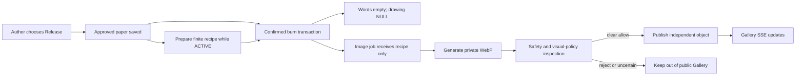

# Throwaway: public Gallery and AI keepsakes

Date: 2026-10-18. Status: design for the requested Claude implementation handoff; application code is not changed by this document.

## 1. Agreed intent and current baseline

The owner explicitly selected **an anonymous public Gallery whose eligibility comes from the existing Release choice**. Do not add an opt-in control. Explain the public AI keepsake in the Release description. Every Release paper successfully destroyed through the existing ritual automatically enters the generation queue; only generated images that pass inspection become public. Keep papers never produce keepsakes, including when their author destroys them. The Gallery must neither display the original words/drawing nor expose a link back to that paper. This request supersedes the old Gallery exclusion in CLAUDE.md for this feature only.

This extends the complete project, not the archived Week 9 increment. Source inspected at `08a7e9e` already implements writing, drawing, witnessing, Keep/Release, furnace confirmation, SSE, return keys and image-aware moderation. Drawing already has Pen, Eraser, Undo and Clear. Do not rebuild these. Current database migrations end at version 8. Source inspection is not a claim that the latest checkout or deployment has passed runtime checks; the implementer must establish a fresh baseline.

Success is a complete local journey: choose Release → publish an immutable paper → confirm its destruction → clear the original immediately → automatically queue, generate and inspect an independent image → show it to all open Gallery sessions. Also deliver the real OpenAI adapter, recovery, public reporting and private operator removal. Fixture demonstrations alone must not be described as verified real-image generation.

## 2. Product decisions

- Only the author chooses Keep or Release at creation. Existing immutable `papers.mode` is the sole eligibility field; add no consent boolean, checkbox, disclosure panel or request-body field. Any authorized visitor can later burn a Release paper; its Gallery outcome was already determined by its author's Release choice. Existing ACTIVE Release papers also qualify. Never reconstruct already DESTROYED or QUARANTINED papers, and never backfill Keep papers.
- An AI keepsake is a **2D image of an abstract object**, not a generated 3D model, screenshot, quotation, reconstructed drawing, personal archive or therapeutic assessment.
- `/gallery/` is a new public page. Object details are a dialog inside that page, not `/paper/:id` or a personal route. No My Keepsakes, profiles, likes, comments, search, chronological feed or popularity.
- A successful burn commits independently of AI availability. It still starts the existing fire only after server confirmation. Gallery work cannot delay the burn HTTP response with an external request.
- Quarantine never creates a keepsake. It cancels preparation and invalidates late results. Normal final reading of a destroyed paper remains available to an already-open reader; quarantine removes it immediately as today.
- The Gallery stores a separate derivative. Burning therefore removes the original, **not every trace of the experience**. Say this in the Release description before publication. No public source link is promised; absolute unlinkability is not promised, because an observer may infer connections from timing.
- Published objects persist until operator removal. Do not promise permanent hosting or silently retire older objects to make space. At storage capacity, stop accepting additional generated files; paper use and existing Gallery viewing continue.

### Exact English Release copy

Keep the existing Keep/Release controls and existing I understand checkbox. Replace only the Release supporting description with:

> Its fate is no longer yours to control. When burned, it will automatically become an anonymous AI keepsake in the public Gallery. Your original words and drawing will be deleted.

Place this factual qualification in the existing safety explanation or About page, not in a new consent control:

> OpenAI helps turn released papers into abstract images. Only generated images that pass safety checks appear in the Gallery. Generation can fail or be delayed; the original paper is still gone.

The first sentence describes the automatic product path, not a guarantee of model availability. Queued work remains durable when generation is paused or capped. Do not disable Release, restore originals or add a second confirmation when the image provider is unavailable. The existing I understand validation remains unchanged.

## 3. Architecture choice

| Approach | Cost/trade-off | Decision |
| --- | --- | --- |
| Keep raw words/drawing in a post-burn generation job | Easy to implement, but defeats immediate original removal and leaks a hidden archive | Reject |
| Generate a full image synchronously before confirming destruction | Slows the ritual, couples destruction to model outages and conflicts with the existing eight-second burn timeout | Reject |
| Prepare a constrained visual recipe while ACTIVE; render after destruction | Extra state transitions; an immediate burn may need a neutral recipe. Original content is never needed by the image job | Choose |

Use the existing React/Vite, Express, SQLite and single Fly machine. Add one serial, in-process artifact worker with durable SQLite jobs, not Redis, another machine, Supabase, a new framework or an image-processing service. Keep the existing paper-review worker independent.

### Recipe, including the immediate-burn race

`Recipe` has exactly four required enum keys; reject unknown keys and values:

- `motif`: `vessel | knot | seed | arch | ribbon | stone`
- `material`: `paper | clay | glass | charcoal`
- `palette`: `ivory | slate | sage | ochre`
- `gesture`: `held | opening | balanced | scattered`

No title, narrative, emotion label, quote, free-text prompt, name, place or original drawing is allowed in the stored recipe. Build the image prompt from server-owned phrases and these enums only. Treat paper content and embedded instructions as untrusted data. A recipe is an abstraction, not an explanation of what the author meant.

After an allowed Release save, queue preparation metadata in the same transaction. Keep saves do not create artifact jobs. On startup, discover existing ACTIVE Release papers in bounded batches of 20 and queue missing preparation metadata without reading their bodies into jobs; never discover ended papers. A Release burn creates its missing job inside the burn transaction if discovery has not reached it. The worker reads content/drawing from the ACTIVE paper into memory and requests strict structured output with `store: false`. Before persisting the response, recheck job lease, ACTIVE status and RELEASE mode in a transaction. Never copy source content into a job, filename, log or error.

Inside a successful burn transaction, clear `content` and `drawing` exactly as now, then create or transition that Release paper's unique job to `IMAGE_QUEUED`. Keep a prepared recipe if available. Otherwise choose a neutral enum recipe deterministically from the job's independent random public UUID, never a hash of the paper text. Invalidate any preparation lease so a late response cannot overwrite that recipe. Quarantine instead cancels the job. Abort in-flight preparation where practical; do not claim to recall data already sent to an external provider.

## 4. Storage and state contracts

Append migration 9; never edit migrations 1–8. It adds:

| Location | Required fields/responsibility |
| --- | --- |
| `artifact_jobs` | Private UUID `id`; unique `paper_id`; independent unique UUID `public_id`; state; recipe JSON; attempt counters; lease token/until; next attempt; private filename; safe error code; internal timestamps |
| `artifacts` | Public UUID `id`; private unique `job_id`; `PUBLISHED`/`HIDDEN`; version; validated private filename; width/height; enum-derived title/alt; internal timestamps |
| `gallery_state` | Singleton integer revision, independent of the paper shared revision |
| `artifact_budgets` | UTC date and atomically reserved preparation-request, image-request and inspection-run counters |
| `artifact_reports` | Artifact ID, private reporter identity, reason enum, operation key, status, timestamps; uniqueness for identity/artifact and identity/op-key |
| `artifact_admin_jobs` | Private queued hide/dismiss/explicitly acknowledged retry actions, consumed by the running process so removal is broadcast after commit |

Private tombstone associations are needed for deduplication and safety. They are never public source links and contain no retained original body. New keepsake tables must not contain source body/drawing columns.

Keep the existing submission API, frozen retry payload and request digests unchanged. Mode already participates in the digest. Changing Keep to Release under the same submission key continues to return the existing 409. No client-supplied artifact flag can enable a Keep paper or suppress a Release paper's automatic job.

Job states:

`PREPARE_QUEUED → PREPARING → PREPARED → IMAGE_QUEUED → GENERATING → REVIEW_QUEUED → REVIEWING → PUBLISHED`

Terminal/exception states: `FAILED`, `BLOCKED`, `CANCELLED`, `GENERATION_UNKNOWN`. A burn may move any preparation state directly to `IMAGE_QUEUED` with the neutral recipe. A publication receipt, two simultaneous burners or restart may never produce a second job/public object for one paper.

### Worker and provider defaults

- `ARTIFACTS_ENABLED=0` by default pauses all artifact-provider requests, not eligibility. Every successful Release burn still creates its unique durable image job. Gallery reads, report handling and operator removal remain available. Existing private files wait for inspection until processing is enabled with a configured provider; core paper moderation is unaffected.
- `ARTIFACT_PROVIDER=openai` for real service; `fixture` only for local tests/CI and refused whenever running on Fly, including when the feature flag is off.
- `ARTIFACT_IMAGE_MODEL=gpt-image-2`; `ARTIFACT_RECIPE_MODEL=gpt-4.1-mini-2025-04-14`. Models are configurable server-side; no silent fallback on access errors.
- Images API: `/v1/images/generations`, `n=1`, `size=1024x1024`, `quality=medium`, `output_format=webp`, `output_compression=80`, `background=opaque`, `moderation=auto`. Do not send legacy `response_format` or `style` parameters. Use native fetch with explicit retry handling, not hidden SDK retries.
- One artifact job executes at a time. Poll due work every 1,000 ms; intervals may be injected shorter in tests. Prioritize output inspection and operator removal over new recipes/images.
- Timeouts: recipe 10 seconds, generation 120 seconds, each inspection request 30 seconds. Lease: 180 seconds, matched by a random token on every result write. Shutdown aborts requests before closing the database.
- Per UTC day: at most 20 preparation requests, 10 image requests, 20 output inspection runs. Every dispatched request/reservation counts even on refusal or timeout. An inspection run can include the category screen, existing content policy and the additional visual-policy check.
- Discovery/claim batches contain at most 20 metadata rows; do not limit the queue to 20 papers or silently drop eligible Release burns. Daily budget exhaustion leaves jobs queued until the next UTC day. Storage exhaustion leaves image jobs queued with a safe capacity reason and a next check after 60 seconds; do not start an image request without space.
- No more than 200 public objects, 250 MiB of artifact files including staging, or a 2 MiB decoded image file. Require at least 64 MiB free disk before starting an image request. Recheck byte capacity at finalization. Do not delete original papers or published objects to recover capacity.

Use `/data/artifacts` on Fly. Derive the default directory from the database directory and allow `ARTIFACT_DIR` for isolated tests. Files are generated UUID `.webp` names, not user-controlled paths. Check response/body limits, base64 decoding, WebP signature and expected dimensions before atomic temp-write/fsync/rename. Do not fetch model-returned URLs. Do not mount this directory with unrestricted express.static.

### Retry and crash rules

- Recipe failures: at most two requests while the paper is ACTIVE, with a five-second retry delay. No recipe after destruction; use the neutral recipe instead.
- Image timeout, connection loss after dispatch, process death during generation or ambiguous 5xx: `GENERATION_UNKNOWN`; **no automatic new image request**. The API does not establish application-level exactly-once billing. Database uniqueness guarantees one published object, not one external charge.
- An explicit 429 may be retried once after at least 30 seconds and Retry-After, within the daily cap. 401/403 are configuration failures; refusals are terminal, not reasons to weaken safety.
- If a finalized private file exists after a crash but its DB transition was lost, validate it and resume inspection without another generation call. Partial files never publish; remove abandoned staging files.
- Inspect a generated image before publishing. Use the existing real moderation machinery for harmful content, plus a separate strict visual-policy result rejecting legible text, faces, identifiable places or uncertainty. Do not change the core moderation prompt to perform creative work.
- Inspection transient errors: at most three inspection runs in total, the first immediately, the second after 5 seconds and the third after 30 seconds. Failed/uncertain images stay private and are eventually unlinked. Never use an uninspected image as an availability fallback.
- A private operator retry of `GENERATION_UNKNOWN` requires explicit acknowledgement of possible extra charges. No public regenerate endpoint.

The serial worker cannot wake a stopped Fly machine. Queued jobs persist and resume when the app next runs. Do not change the course Fly machine/auto-stop settings or promise a completion time. Once publication commits, propagate that change to open Gallery sessions within about one second.

## 5. Public contracts

`PublicArtifact = { id, version, image_url, width:1024, height:1024, title, alt }`.

Construct it with an allowlist. No source paper/job ID, owner, raw recipe, source timestamps, request digest, raw prompt, provider response, original words/drawing or report count. Titles and alt text come from fixed motif/material phrase maps, not source-derived free text.

| Endpoint | Contract |
| --- | --- |
| `GET /api/gallery/config` | `{ generation_enabled:boolean }`; true only when processing is enabled and a provider is configured; this reports processing, not eligibility; no keys, models or quota ledgers |
| `GET /api/gallery?limit=12&after=<uuid>` | Random-UUID ascending keyset order, not newest-first; `{ revision, items, next_cursor:string|null, total }`; limit 1–24, malformed cursor 400 |
| `GET /api/gallery/:id` | Public metadata for a PUBLISHED object; hidden/missing returns 404 |
| `GET /api/gallery/:id/image` | Check PUBLISHED state before serving the validated local WebP; `Cache-Control: no-store`; hidden/missing 404, no directory traversal |
| `GET /api/gallery/events` | Separate public SSE channel; snapshot plus `artifact:published` and `artifact:hidden`; revisioned, no original-paper events |
| `POST /api/gallery/:id/reports` | Existing anonymous session required; `{reason,op_key}`; same six reason enums as paper reports; 201 `{report_id,status:'queued'}`; repeat identical request returns same receipt; conflicting reuse 409 |

Reuse existing session, input-validation and address/rate-limit patterns. Reports have no additional free-text note in this first Gallery release. Limit each identity to 5 artifact reports/hour and one per object; enforce an additional per-address bound following existing trusted-proxy handling. Reports do not hide objects or change either total by themselves. Generated-image checks are automated; Gallery reports in this version enter a private operator review queue rather than an automatic report-triggered model decision. Hide resolves associated reports; dismiss resolves one report without changing visibility.

Gallery SSE snapshots cover the first 12 public objects and revision. The client retains an opened detail ID only after revalidating it with the single-object endpoint on reconnect; a hidden/missing object closes its detail and clears its image. Reconcile from a fresh snapshot, do not replay old arrivals. Buffer deltas during pending HTTP snapshot/page loads; discard stale revisions and duplicate versions. Keep at most 48 tile entries and preserve an opened object when evicting other tiles. Pagination uses the last server page cursor, not a cursor recomputed from live inserted tiles. Deduplicate live arrivals against later pages. More objects are explored in the same unordered collection, not a chronological feed.

Publication/hiding changes only `gallery_state.revision`, not paper revision or active-paper total. Emit events after commit. Reuse existing heartbeat/backpressure conventions: 20-second heartbeat and 256 KiB maximum pending output.

## 6. Gallery experience and references

- A quiet exhibition on the current mineral-gray background, warm paper tones and charcoal type. Header: Throwaway, Back to the space, About. Add Gallery to the main space header only when it is not busy with a draft, reading or ritual.
- Title: **The Gallery**. Introduction: **Abstract objects left after a paper was let go. The original words and drawings are gone.**
- Maximum content width 1,200 px. Three image columns at ≥1,024 px, two at 600–1,023 px, one below 600 px; 48 px desktop and 20 px phone gutters. Square images, sparse captions, no card chrome, badges, timestamps or ranking. Objects are public collection items, not a latest feed.
- Lazy-load images with explicit dimensions/aspect ratio and async decoding. Gallery entry must not initialize Three.js or download the room/fire chunks. No image editor, GLB generation or new animation library.
- Open a larger image in a native dialog with a plain cross, accessible label, initial dialog focus, Escape, focus return, report and close actions. No source reconstruction or paper recovery control.
- Empty: **No objects have arrived yet.** Secondary: **Released papers leave abstract keepsakes here after they are burned and their images pass safety checks.**
- When processing is paused, show **New objects are not being generated right now.** Existing objects remain viewable. Loading: **Opening the Gallery…** Failure: **The Gallery could not be opened. Try again.** Reconnection retains the current safe view while reconciling; hidden objects disappear from grid and detail live.
- Preserve the furnace's existing ash dwell and Back control. The Gallery is reached through the header after returning to the space; do not add a ritual link that bypasses scene cleanup or sends a Keep author a generation promise. No automatic Gallery navigation or paper-to-object lookup.
- Keep 16 px input text and 44 px controls. Preserve current header/count positions, paper materials, drawing tabs, scene bounds and recent physics work. Use fluid sizing and verify the longer Release description at 1,280×720 and 390×844. Do not hide controls, shrink input text below 16 px or add another consent control.

Use [space materials](../../../reference-images/01-space-desktop.png), [writing sheet](../../../reference-images/02-write-desktop.png), [mobile writing](../../../reference-images/08-write-mobile.png) and [reading material](../../../reference-images/03-read-desktop.png) as material references. These older images do not authorize reverting newer header/counter placement. Capture the actual current app before edits. No new paid reference-image generation is part of this plan.

## 7. Operator and acceptance boundaries

Provide a private CLI: `reports`, `hide <artifact-id> --reason <code>`, `dismiss <report-id>`, and an explicitly confirmed `retry <job-id>` for uncertain generation. Hide/dismiss enqueue maintenance for the running worker; the CLI must say queued until applied. Removing an object updates its version, Gallery total/revision, file-serving authorization and SSE in one logical operation. Clear its open detail immediately on clients; remove the private file after state protection commits. Never expose these commands as unauthenticated HTTP routes.

Require tests for migration compatibility, Release-only automatic eligibility, unchanged mode-bound idempotency, simultaneous burns, no artifact on quarantine, late preparation responses, private-file recovery, ambiguous generation, quotas, source-data absence, safe image serving, reporting, operator hide, SSE reconnect and three viewport sizes. Preserve existing invariants and drawing tests. Do not reuse an old 115-test count as the current baseline.

This planning task makes no application change, paid API call, credential change, commit, push or deployment. The future unattended implementation is local-first, fixture-driven, and uses task-scoped commits. Real-image quality/access needs one separately authorized paid smoke test with synthetic content. Missing credentials must not block local work or cause fake success. Main push, production migration, secret changes and deployment remain a separate release step after review, with a current consistent database backup and the image directory included in future backups.

## 8. Official API references checked for this design

- [Images API and supported parameters](https://developers.openai.com/api/reference/resources/images/methods/generate): GPT image models return base64 image data; WebP output and compression are supported. Account/model access is not established by documentation.
- [Image generation guide](https://developers.openai.com/api/docs/guides/image-generation): model/quality behavior and output considerations.
- [Structured outputs](https://developers.openai.com/api/docs/guides/structured-outputs): strict schemas still require refusal, incomplete-response and local validation handling.

The queue design, privacy choices, limits and UI rules above are project decisions, not claims made by those API documents. Recheck the official request schema at implementation time without silently changing the chosen model or broadening permissions. The existing CLAUDE.md static-asset generation guidance does not define this runtime API; document the runtime OpenAI adapter as this feature's explicit exception without changing unrelated static assets.
